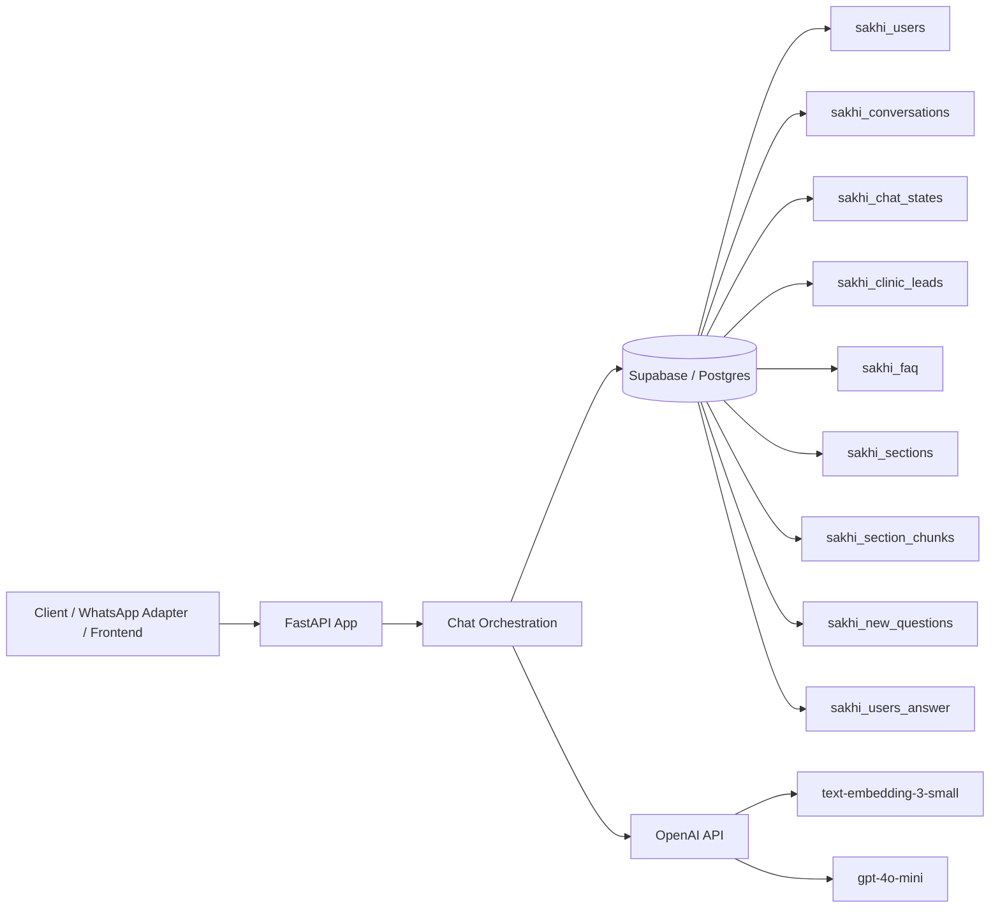
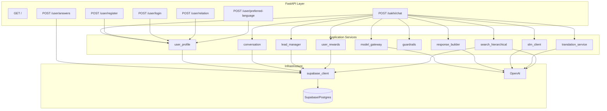
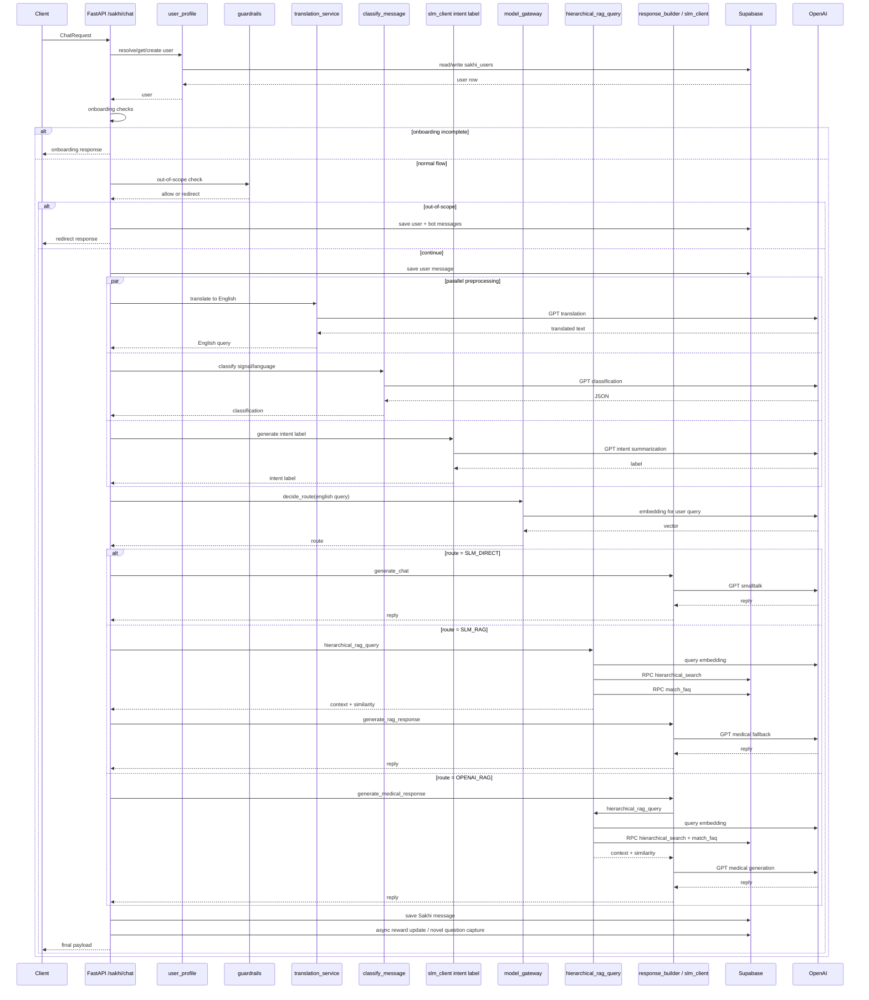
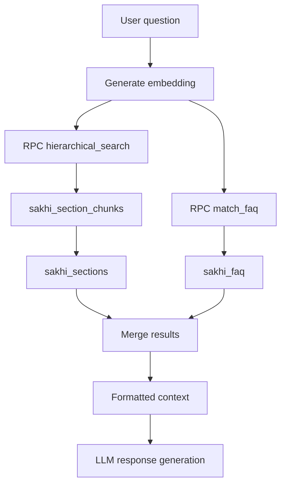
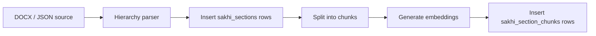
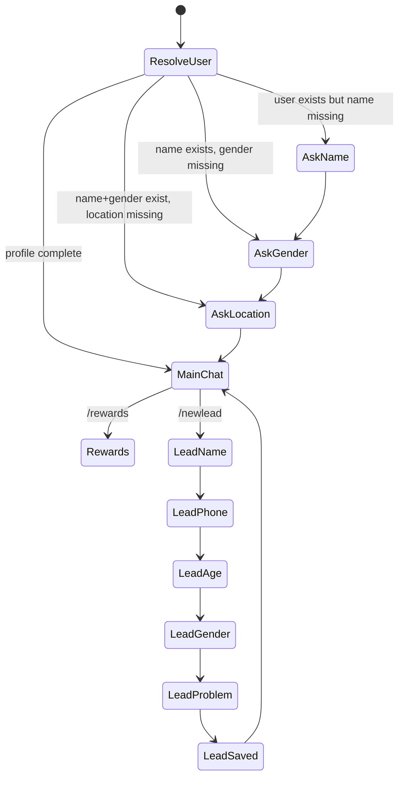
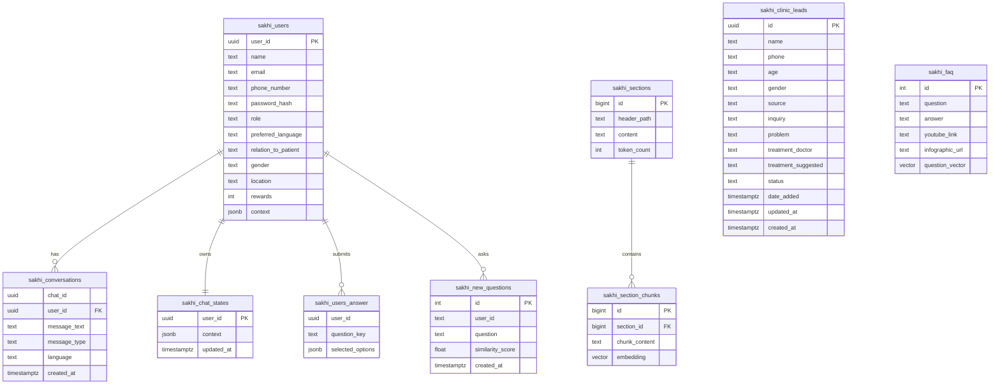
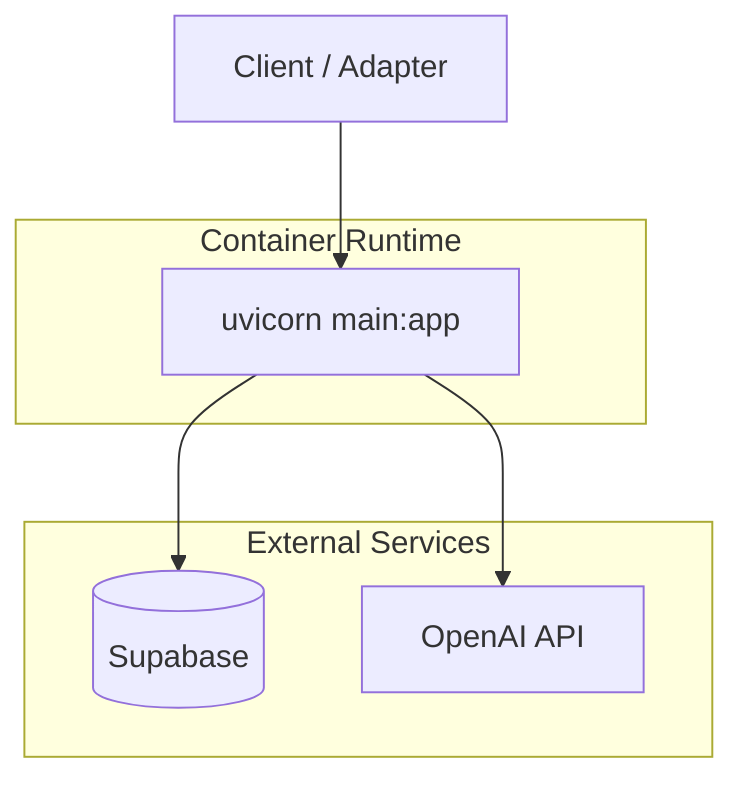
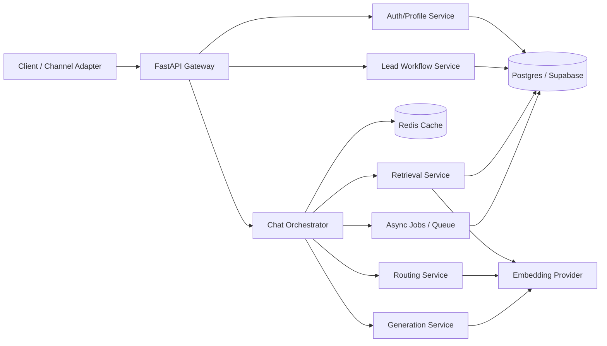

# Sakhi WhatsApp Backend: Architecture Trace and System Design

## Scope

This document traces the current architecture directly from the codebase and SQL scripts in this repository. It describes:

- Runtime components
- Request and response flow
- State management
- Retrieval and knowledge ingestion
- Database model
- Deployment shape
- Current design constraints and risks

Primary implementation references:

- [main.py](/d:/Ottobon/Sakhi-Whatsapp-Backend/main.py)
- [modules/response_builder.py](/d:/Ottobon/Sakhi-Whatsapp-Backend/modules/response_builder.py)
- [modules/slm_client.py](/d:/Ottobon/Sakhi-Whatsapp-Backend/modules/slm_client.py)
- [modules/model_gateway.py](/d:/Ottobon/Sakhi-Whatsapp-Backend/modules/model_gateway.py)
- [modules/search_hierarchical.py](/d:/Ottobon/Sakhi-Whatsapp-Backend/modules/search_hierarchical.py)
- [modules/lead_manager.py](/d:/Ottobon/Sakhi-Whatsapp-Backend/modules/lead_manager.py)
- [supabase_client.py](/d:/Ottobon/Sakhi-Whatsapp-Backend/supabase_client.py)
- [sql/setup_hierarchical_rag.sql](/d:/Ottobon/Sakhi-Whatsapp-Backend/sql/setup_hierarchical_rag.sql)
- [sql/setup_leads_strict.sql](/d:/Ottobon/Sakhi-Whatsapp-Backend/sql/setup_leads_strict.sql)
- [sql/setup_rewards.sql](/d:/Ottobon/Sakhi-Whatsapp-Backend/sql/setup_rewards.sql)
- [sql/update_faq_rpc.sql](/d:/Ottobon/Sakhi-Whatsapp-Backend/sql/update_faq_rpc.sql)

## Executive Summary

The backend is a FastAPI service that acts as an orchestration layer around:

- Supabase/Postgres for persistent state and vector search
- OpenAI for embeddings, translation, classification, rewriting, and most response generation
- A semantic router that decides whether a request is treated as small talk, simple medical, or complex medical

The system is mostly stateless at the API layer. Durable state is externalized to Supabase:

- User profile and onboarding state in `sakhi_users`
- Chat history in `sakhi_conversations`
- Lead-capture workflow state in `sakhi_chat_states`
- Reward points in `sakhi_users.rewards`
- Novel question capture in `sakhi_new_questions`
- Medical knowledge in `sakhi_sections`, `sakhi_section_chunks`, and `sakhi_faq`

Although the code refers to an SLM path, the current implementation runs effectively in OpenAI-only mode because `SLMClient` disables the external SLM endpoint and falls back to GPT-based generation.

## System Context



## Runtime Architecture

### Main subsystems

1. API layer
   - FastAPI app and endpoint definitions in [main.py](/d:/Ottobon/Sakhi-Whatsapp-Backend/main.py).

2. User and conversation persistence
   - User profile CRUD in [modules/user_profile.py](/d:/Ottobon/Sakhi-Whatsapp-Backend/modules/user_profile.py).
   - Conversation logging and retrieval in [modules/conversation.py](/d:/Ottobon/Sakhi-Whatsapp-Backend/modules/conversation.py).

3. Request analysis and routing
   - Language and signal classification in [modules/response_builder.py](/d:/Ottobon/Sakhi-Whatsapp-Backend/modules/response_builder.py).
   - Semantic route selection in [modules/model_gateway.py](/d:/Ottobon/Sakhi-Whatsapp-Backend/modules/model_gateway.py).
   - Topic scope enforcement in [modules/guardrails.py](/d:/Ottobon/Sakhi-Whatsapp-Backend/modules/guardrails.py).

4. Response generation
   - Small talk and medical response generation in [modules/response_builder.py](/d:/Ottobon/Sakhi-Whatsapp-Backend/modules/response_builder.py).
   - SLM facade and GPT fallback behavior in [modules/slm_client.py](/d:/Ottobon/Sakhi-Whatsapp-Backend/modules/slm_client.py).

5. Retrieval
   - Embedding generation in [rag.py](/d:/Ottobon/Sakhi-Whatsapp-Backend/rag.py).
   - Hierarchical vector search in [modules/search_hierarchical.py](/d:/Ottobon/Sakhi-Whatsapp-Backend/modules/search_hierarchical.py).

6. Workflow/state features
   - Onboarding state machine in [main.py](/d:/Ottobon/Sakhi-Whatsapp-Backend/main.py).
   - Lead capture flow in [modules/lead_manager.py](/d:/Ottobon/Sakhi-Whatsapp-Backend/modules/lead_manager.py).
   - Reward system in [modules/user_rewards.py](/d:/Ottobon/Sakhi-Whatsapp-Backend/modules/user_rewards.py).

### Component diagram



## API Surface

Current HTTP endpoints in [main.py](/d:/Ottobon/Sakhi-Whatsapp-Backend/main.py):

- `GET /`
- `POST /user/register`
- `POST /user/login`
- `POST /sakhi/chat`
- `POST /user/answers`
- `POST /user/relation`
- `POST /user/preferred-language`

Notes:

- `POST /user/register` is defined twice in `main.py`. Functionally this is redundant and should be cleaned up.
- `allow_origins=["*"]` is configured for CORS, which is acceptable for development but too open for production.

## Core Chat Flow

### High-level request lifecycle

`/sakhi/chat` is the main orchestration path.

1. Resolve the user by `user_id` or `phone_number`.
2. If user does not exist and phone number is present, create a partial user.
3. Run onboarding if `name`, `gender`, or `location` is still missing.
4. Intercept command-style flows:
   - `/rewards`
   - `/newlead`
   - in-progress lead workflow
5. Run out-of-scope guardrails.
6. Persist the user message to conversation history.
7. Launch in parallel:
   - translation to English for routing/search
   - classification for signal/language
   - intent label generation
8. Route the query using the semantic router.
9. Generate reply through one of three paths:
   - `SLM_DIRECT`
   - `SLM_RAG`
   - `OPENAI_RAG`
10. Persist Sakhi response.
11. Attach metadata such as `youtube_link` and `infographic_url` when present.
12. Trigger asynchronous reward updates and optional new-question capture.

### Sequence diagram: `/sakhi/chat`



## Routing and Model Strategy

### Logical routes

The router in [modules/model_gateway.py](/d:/Ottobon/Sakhi-Whatsapp-Backend/modules/model_gateway.py) exposes three destinations:

- `SLM_DIRECT`
  - Greetings, small talk, lightweight conversational turns
- `SLM_RAG`
  - Simpler medical and facility-info queries
- `OPENAI_RAG`
  - Complex medical or low-confidence cases

### How routing works

The route is chosen by semantic similarity between the query embedding and precomputed anchor embeddings for:

- small talk
- multiple simple medical categories
- medical complexity markers
- facility/location info

Important current-state detail:

- The router uses OpenAI embeddings at runtime.
- Anchor vectors are computed during singleton initialization.
- This means application startup depends on external embedding calls.

### Effective model behavior today

Although the names suggest an external SLM path, [modules/slm_client.py](/d:/Ottobon/Sakhi-Whatsapp-Backend/modules/slm_client.py) sets:

- `self.endpoint_url = None`
- old SLM HTTP logic behind `if False`

So the actual current behavior is:

- `SLM_DIRECT` -> GPT-based smalltalk generation
- `SLM_RAG` -> GPT-based medical generation via the fallback path
- `OPENAI_RAG` -> GPT-based medical generation directly

In practice, routing mostly controls prompt style and retrieval path, not provider selection.

## Language Handling Design

### Inputs

The system supports:

- English
- Telugu
- Tinglish
- partial handling for Hindi in classifier output

### Processing pattern

1. Deterministic local language heuristics in [modules/detect_lang.py](/d:/Ottobon/Sakhi-Whatsapp-Backend/modules/detect_lang.py)
2. LLM-based classification refinement in `classify_message`
3. Translation to English for routing and retrieval in [modules/translation_service.py](/d:/Ottobon/Sakhi-Whatsapp-Backend/modules/translation_service.py)
4. Language-locked generation or forced rewrite for:
   - Tinglish
   - Telugu

### Design intent

The system tries to:

- search and route in English for better recall
- answer in the user’s conversational language
- use rewrite passes when direct model output violates target-language constraints

## Retrieval-Augmented Generation Design

### Data model for retrieval

Hierarchical RAG is implemented using:

- `sakhi_sections`
  - stores full parent section content
- `sakhi_section_chunks`
  - stores smaller searchable chunks with embeddings
- `sakhi_faq`
  - stores FAQ question vectors and media metadata

### Retrieval pattern

`hierarchical_rag_query` in [modules/search_hierarchical.py](/d:/Ottobon/Sakhi-Whatsapp-Backend/modules/search_hierarchical.py):

1. Generates an embedding for the user query.
2. Calls `hierarchical_search` RPC over `sakhi_section_chunks`.
3. Calls `match_faq` RPC over `sakhi_faq`.
4. Merges results.
5. Returns:
   - merged retrieval context
   - best similarity score

### Retrieval architecture



### Why the hierarchy exists

The SQL in [sql/setup_hierarchical_rag.sql](/d:/Ottobon/Sakhi-Whatsapp-Backend/sql/setup_hierarchical_rag.sql) uses small chunks for search but returns full parent section content. This is a classic design to balance:

- good recall from small semantic chunks
- better answer quality from larger contextual passages

## Knowledge Ingestion Pipeline

The repository includes offline ingestion utilities:

- [scripts/ingest_hierarchical.py](/d:/Ottobon/Sakhi-Whatsapp-Backend/scripts/ingest_hierarchical.py)
- [scripts/ingest_json.py](/d:/Ottobon/Sakhi-Whatsapp-Backend/scripts/ingest_json.py)

### Ingestion flow

1. Read a structured `.docx` or hierarchical `.json`.
2. Parse document hierarchy.
3. Insert parent sections into `sakhi_sections`.
4. Split section content into chunks.
5. Generate embeddings per chunk via OpenAI.
6. Insert searchable chunks into `sakhi_section_chunks`.

### Ingestion diagram



## State Management

The system uses multiple state stores, each for a specific concern.

### 1. User identity and onboarding state

Stored in `sakhi_users`.

Used fields include:

- `user_id`
- `phone_number`
- `name`
- `gender`
- `location`
- `preferred_language`
- `relation_to_patient`
- `rewards`

Onboarding is not stored as an explicit state enum. Instead, it is inferred from null checks:

- no `name` -> ask name
- no `gender` -> ask gender
- no `location` -> ask location

### 2. Lead-capture workflow state

Stored in `sakhi_chat_states.context`.

This holds a JSON payload shaped like:

```json
{
  "lead_flow": {
    "step": "ask_name",
    "data": {
      "name": "...",
      "phone": "...",
      "age": "...",
      "gender": "..."
    }
  }
}
```

### 3. Conversation memory

Stored in `sakhi_conversations`.

Each turn is persisted, then the last few messages are reloaded for prompt history.

### State diagram: onboarding and lead flow



## Data Model

### Core tables and relationships



### Notes on schema usage

- `sakhi_users.context` still exists in code but lead flow has moved to `sakhi_chat_states`.
- `sakhi_new_questions.user_id` is `TEXT`, while most user identifiers are UUIDs.
- `sakhi_conversations` write path assigns `chat_id` only to Sakhi messages, not user messages.

## Lead Management Subsystem

The lead subsystem is isolated from normal medical chat except for entry through `/sakhi/chat`.

### Flow

1. User sends `/newlead`.
2. `lead_manager` initializes `sakhi_chat_states.context.lead_flow`.
3. Subsequent user replies are interpreted as step input.
4. On final step, a row is inserted into `sakhi_clinic_leads`.
5. State is cleared by setting `lead_flow` to `None`.

### Design intent

This is a conversational data capture workflow embedded inside the same chat endpoint, rather than a separate lead API.

## Reward System

The reward subsystem is asynchronous and non-blocking.

### Rules

- `CONVERSATIONAL` -> 1 point
- `FOLLOW_UP` -> 2 points
- `MEDICAL` -> 3 points
- `NEW_QUESTION` -> 5 points

### Triggering behavior

- small talk route awards conversational points
- medical routes award medical or new-question points based on similarity threshold
- novel questions are also persisted to `sakhi_new_questions`

## Deployment Design

### Current deployment model

The repository is packaged as a single containerized FastAPI app.

References:

- [Dockerfile](/d:/Ottobon/Sakhi-Whatsapp-Backend/Dockerfile)
- [docker-compose.yml](/d:/Ottobon/Sakhi-Whatsapp-Backend/docker-compose.yml)

### Deployment diagram



### Characteristics

- Single service process
- No internal queue
- No cache layer
- No worker tier
- No separate retrieval service
- No dedicated auth service

## System Design Assessment

### What the design does well

- Keeps the API layer simple and thin.
- Pushes durable state into a managed database.
- Uses vector retrieval in a way that preserves larger contextual passages.
- Separates lead workflow state from core user profile.
- Uses parallel async preprocessing for translation, classification, and intent labeling.

### Current architectural constraints

1. OpenAI is on the hot path multiple times per request.
   - A single chat turn may perform translation, classification, intent labeling, embedding generation, and final generation.

2. The named SLM architecture is not materially active.
   - The route names suggest provider diversification, but the implementation currently collapses back to GPT.

3. Startup depends on remote embedding calls.
   - `ModelGateway` computes anchor vectors on initialization.

4. Supabase is both OLTP store and vector retrieval backend.
   - This is simple operationally, but centralizes nearly all state and retrieval load in one external dependency.

5. No caching layer exists.
   - Frequent reads occur for user profile, rewards, chat history, and routing-related operations.

6. Security posture is not production-ready in some areas.
   - Passwords are compared as plain text in [modules/user_profile.py](/d:/Ottobon/Sakhi-Whatsapp-Backend/modules/user_profile.py).
   - CORS is fully open.
   - Service-role access is used from the backend for broad database operations.

7. Some implementation duplication exists.
   - Duplicate `/user/register` route.
   - Repeated keys in response payloads such as `reply` and `infographic_url` assignments.

### Recommended target architecture evolution

If this backend is expected to scale, the next clean design would be:

1. Keep FastAPI as the orchestration gateway.
2. Split generation concerns into explicit services/modules:
   - classifier/router
   - retriever
   - response generator
3. Add Redis for:
   - recent profile cache
   - short conversation history cache
   - precomputed router anchors
4. Make the SLM route real if latency/cost optimization is still a goal.
5. Precompute and persist router anchors instead of generating them at startup.
6. Move non-critical work off the request thread:
   - rewards
   - analytics
   - novel question capture
   - optional follow-up generation
7. Replace plain-text password handling with hashed authentication.

## Suggested Logical Target Architecture



## Conclusion

The current system is best described as a single-service AI chat backend with database-centric state management and OpenAI-centric intelligence, wrapped by a semantic routing layer and a hierarchical RAG subsystem. It is coherent as an MVP architecture and already has clear subsystem boundaries, but the current implementation still behaves more like a unified GPT orchestration service than a true multi-model architecture.

For documentation and diagramming purposes, the most important mental model is:

- FastAPI orchestrates
- Supabase stores state and performs vector retrieval
- OpenAI powers nearly all intelligence functions
- chat, onboarding, lead capture, rewards, and retrieval are implemented as separable service modules inside one codebase
